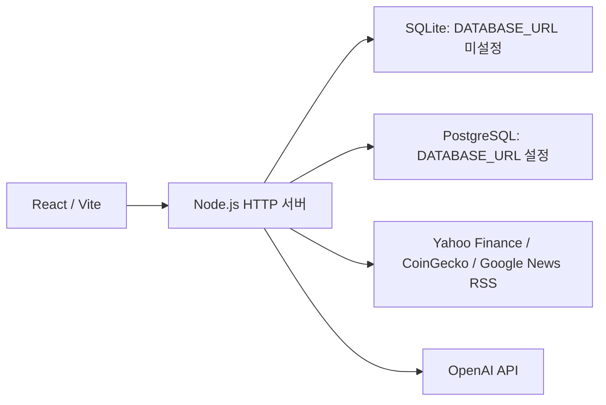

# MoneyPlatform

시장 지수, 암호화폐, 국내·미국 주식, 금융 뉴스와 개인 포트폴리오를 한곳에서 확인하는 투자 정보 웹 서비스입니다. 회원 인증, 관심 자산·뉴스 저장, 커뮤니티, 관리자 기능과 OpenAI API 연동을 구현했습니다.

- 서비스 주소: [money-platform.onrender.com](https://money-platform.onrender.com)
- 프런트엔드: React + Vite
- 백엔드: Node.js 내장 HTTP 모듈
- DB: 로컬 기본 SQLite, `DATABASE_URL` 설정 시 PostgreSQL
- 배포 구성: Render 웹 서비스 + PostgreSQL

## 기술 스택

| 구분 | 사용 기술 | 적용 내용 |
|---|---|---|
| 언어 | JavaScript, HTML, CSS | React 화면, Node.js 서버, 스타일 구현 |
| 화면·빌드 | React, React DOM, Vite | 컴포넌트 구성, 개발 서버, 정적 파일 빌드 |
| 라우팅 | React Router | 페이지 이동, 상세 페이지·모달 라우팅 |
| 서버 데이터 상태 | TanStack Query | API 조회, 변경 요청, 캐시 갱신 |
| 클라이언트 상태 | Zustand, React Context | 관심 자산 상태, 인증·검색 상태 공유 |
| 스타일 | Tailwind CSS | 화면 레이아웃과 UI 스타일 |
| 백엔드 | Node.js `node:http`, `fetch`, `node:crypto` | HTTP 라우팅, 외부 API 호출, 비밀번호 해시와 토큰 서명 |
| 데이터 저장 | SQLite(`node:sqlite`), PostgreSQL(`pg`) | 환경에 따른 DB 연결, 사용자·커뮤니티·보유 자산 저장 |
| AI | OpenAI API | 서버의 `fetch`로 뉴스 요약·포트폴리오 분석·투자 인사이트 요청 |
| 개발 도구 | MSW, React Query Devtools | 선택적인 개발용 모의 API, 개발 환경 쿼리 상태 확인 |
| 검증 도구 | Playwright, ESLint | 브라우저 흐름 테스트, 정적 검사 |
| 배포 | Render | Node.js 웹 서비스와 PostgreSQL 연결 설정 |

기술 설정은 [package.json](package.json), [Vite 설정](vite.config.js), [앱 진입점](src/main.jsx), [HTTP 서버](server/auth-server.js), [DB 모듈](server/db.js)에서 확인할 수 있습니다.

## 주요 기능

### 시장 정보·검색

- 시장 지수, 암호화폐, 국내·미국 주식 목록 조회
- 자산별 상세 정보와 가격 흐름 차트 표시
- 종목·뉴스 검색 및 목록 필터링
- Yahoo Finance, CoinGecko, Google News RSS 연동
- 외부 데이터 요청 실패 시 준비된 샘플 데이터로 대체

외부 데이터 요청과 캐시는 [server/market-data.js](server/market-data.js)에 구현되어 있습니다. 응답에 원본 제공자와 `live`·`fallback` 구분을 포함합니다.

### 회원·관심 자산·저장 뉴스

- 회원가입, 로그인·로그아웃, 저장된 토큰으로 로그인 상태 확인
- 마이페이지, 회원 정보·비밀번호 변경, 회원 탈퇴
- 로그인한 사용자별 관심 자산 조회·추가·삭제
- 뉴스 저장·저장 취소 및 저장한 뉴스 조회
- 자산별 개인 메모 작성·수정

인증 상태는 [AuthContext](src/context/AuthContext.jsx), 관심 자산 상태는 [Zustand 스토어](src/store/favoritesStore.js), 서버 요청은 [API 모듈](src/services/api.js)에서 관리합니다.

### 포트폴리오

- 자산별 보유 수량과 평균 매수가 저장·수정·삭제
- 투자금액, 평가금액, 손익과 수익률 계산
- 자산별 비중과 전체 포트폴리오 요약 표시
- 국내 주식은 원화, 미국 주식·암호화폐는 달러 기준으로 처리
- 달러 자산의 원화 합산에는 현재 **1 USD = 1,380 KRW의 고정 환산값** 사용

계산과 화면 구현은 [PortfolioPage.jsx](src/pages/PortfolioPage.jsx)에 있습니다. 실시간 환율 API는 연동되어 있지 않습니다.

### 커뮤니티·관리자

- 게시글 작성·조회·삭제, 댓글 작성·조회·삭제, 좋아요
- 게시글·댓글 신고
- 관리자 대시보드, 회원 목록·권한·메모 관리
- 관리자 게시글·댓글 삭제, 게시글 숨김·복구
- 신고 상태 변경·삭제
- 공지 작성·수정·숨김·복구·삭제

일반 사용자와 관리자 화면은 [커뮤니티](src/pages/CommunityPage.jsx), [상세 화면](src/components/DetailModal.jsx), [관리자 화면](src/pages/AdminPage.jsx)에서 확인할 수 있습니다. 서버에서도 인증된 사용자와 관리자 권한을 확인합니다.

### AI 기능

- 전달된 뉴스 제목·요약 등의 정보를 바탕으로 뉴스 요약
- 보유 자산의 구성·성과·위험 요소를 설명하는 포트폴리오 분석
- 서버에서 집계한 보유 자산과 관련 뉴스 기반 투자 인사이트
- AI 버튼 클릭 시 요청하며, 화면 진입에 따른 AI 자동 요청과 자동 재시도는 사용하지 않음
- JSON 파싱과 자체 검증 함수로 응답의 필드·타입·길이 확인
- 요청 시간 제한, 결과 캐시, 동일 진행 요청 공유, 요청 빈도·일일 호출 예산 관리
- 일부 응답 오류에 대해 기존 데이터로 구성한 대체 결과 제공

AI 요청은 [ai-service.js](server/ai/ai-service.js), 응답 검증은 [schemas](server/ai/schemas), 캐시는 [ai-cache.js](server/ai/ai-cache.js), 호출 제한은 [ai-rate-limit.js](server/ai/ai-rate-limit.js)에 구현되어 있습니다. 실제 외부 AI 호출에는 유효한 서버용 `OPENAI_API_KEY`가 필요합니다.

## 서비스 구조



개발 중에는 Vite가 `/api` 요청을 Node.js 서버로 프록시합니다. 빌드 후에는 Node.js 서버가 `dist` 정적 파일과 API를 함께 제공합니다. SQLite와 PostgreSQL 중 하나를 환경 설정에 따라 선택합니다.

## 데이터 저장 구조

| 실행 조건 | 저장소 | 연결 방식 |
|---|---|---|
| `DATABASE_URL`이 비어 있음 | SQLite | `node:sqlite`로 `data/money-platform.sqlite` 파일 사용 |
| `DATABASE_URL`이 설정됨 | PostgreSQL | `pg.Pool`로 연결하고 PostgreSQL 쿼리 실행 |

[render.yaml](render.yaml)은 `money-platform-db` PostgreSQL 리소스를 생성하고, 연결 문자열을 웹 서비스의 `DATABASE_URL`에 전달하도록 구성되어 있습니다. `DATABASE_SSL=true`일 때 DB 연결의 SSL 옵션을 활성화합니다. 실제 배포 환경의 값은 Render 설정에 따릅니다.

회원, 관심 자산, 자산 메모, 저장 뉴스, 보유 자산, 게시글·댓글, 공지, 신고와 관리자 메모를 DB에 저장합니다. 관심 자산·보유 자산 등의 중복은 `UNIQUE(user_id, item_key)` 조건으로 구분합니다. 테이블 초기화와 각 DB의 조회·저장 처리는 [server/db.js](server/db.js)에 있습니다.

## 로컬 실행

Render 설정과 동일한 **Node.js 24.16.0** 사용을 권장합니다. 서버에서 `node:sqlite`를 사용합니다.

```bash
npm ci
```

프로젝트 루트에 `.env`를 만들고 로컬 SQLite 실행에 필요한 값을 설정합니다.

```env
AUTH_PORT=3001
JWT_SECRET=replace-with-your-own-random-secret
DATABASE_URL=
VITE_USE_MOCKS=false
```

```bash
npm run dev
```

- 화면: `http://localhost:5173`
- API 서버: `http://localhost:3001`
- 상태 확인: `http://localhost:3001/api/auth/health`

`npm run dev`는 API 서버와 Vite 개발 서버를 함께 시작합니다. API 포트를 바꾸면 [Vite 프록시 설정](vite.config.js)의 대상도 맞춰야 합니다.

### 선택 환경변수

| 환경변수 | 용도 |
|---|---|
| `PORT`, `AUTH_PORT` | API 서버 포트. `PORT`가 우선하며 미설정 시 `3001` |
| `HOST` | API 서버 바인딩 주소. 기본값 `0.0.0.0` |
| `JWT_SECRET` | 서버의 JWT 서명·검증에 사용하는 비밀값 |
| `DATABASE_URL` | PostgreSQL 연결 문자열. 로컬 SQLite 사용 시 비워 둠 |
| `DATABASE_SSL` | `true`이면 PostgreSQL SSL 연결 옵션 활성화 |
| `OPENAI_API_KEY` | 서버 전용 OpenAI API 키 |
| `OPENAI_MODEL` | AI 요청 모델. 코드 기본값 `gpt-4.1-mini` |
| `AI_TIMEOUT_MS` | AI 요청 제한 시간 |
| `AI_MAX_OUTPUT_TOKENS` | AI 응답 최대 토큰 수 |
| `AI_CACHE_TTL_MS`, `AI_CACHE_MAX_ENTRIES` | AI 캐시 보관 시간과 최대 항목 수 |
| `AI_RATE_LIMIT_WINDOW_MS`, `AI_RATE_LIMIT_MAX` | AI 요청 빈도 제한 |
| `AI_MAX_OPENAI_CALLS_PER_DAY`, `AI_MAX_OPENAI_CALLS_PER_USER_PER_DAY` | 서버·사용자별 일일 외부 호출 예산 |
| `AI_TRACE` | `true`이면 투자 인사이트 처리 단계의 시간 로그 기록 |
| `MARKET_TIMEOUT_MS`, `MARKET_CACHE_MS` | 시장 데이터 요청 제한 시간과 캐시 보관 시간 |
| `VITE_API_BASE` | 프런트와 API를 분리할 때 사용할 API 기본 주소 |
| `VITE_USE_MOCKS` | 개발 환경에서 `true`이면 MSW 모의 API 활성화 |

AI 기능을 사용하려면 `.env`에 실제 `OPENAI_API_KEY`를 추가하고 서버를 다시 시작합니다. 비밀값은 서버 환경변수에 설정하며, 브라우저에 전달되는 `VITE_` 변수에 넣지 않습니다.

## 빌드·배포

```bash
npm run build
npm start
```

`npm run build`는 프런트 파일을 `dist`에 생성하고, `npm start`는 HTTP 서버를 실행합니다.

[Render Blueprint](render.yaml)의 설정:

- 웹 서비스: `money-platform`, Node.js 런타임
- 빌드: `npm ci --include=dev && npm run build`
- 시작: `npm start`
- 상태 확인 경로: `/api/auth/health`
- PostgreSQL: `money-platform-db` 연결 문자열을 `DATABASE_URL`로 주입

## 검증 명령과 작성된 테스트

```bash
npm run lint
npm run build
npx playwright install chromium
npm run test:e2e
```

[tests/msw.spec.js](tests/msw.spec.js)에 작성된 브라우저 테스트는 다음 7개입니다. 아래 목록은 테스트 구현 범위이며, 현재 실행 결과를 뜻하지 않습니다.

1. 시장 데이터 API 응답 확인
2. 상세 페이지 주소 직접 접속
3. 종목 검색 필터링
4. 회원가입 후 로그인 및 잘못된 비밀번호 처리
5. 비로그인·일반 사용자 화면의 접근 제한
6. 뉴스 AI 요약 버튼 클릭 전후의 API 호출 확인
7. 존재하지 않는 경로의 404 화면

MSW는 `VITE_USE_MOCKS=true`인 개발 환경에서 선택적으로 사용하며, 위 Playwright 테스트의 실행과는 별도로 설정됩니다.

## 구현에서 고려한 점

- `node:crypto`의 salt와 scrypt로 비밀번호를 해시하고, HMAC-SHA256 서명을 사용하는 JWT를 검증합니다.
- 개인 데이터 API는 인증된 사용자 기준으로 조회·저장하고 관리자 API는 관리자 권한을 확인합니다.
- HTTP 요청 본문 크기와 인증 요청 빈도를 제한합니다.
- 보유 자산 변경 후 관련 조회 캐시와 AI 분석 상태를 갱신합니다.
- 외부 시장 데이터와 AI 응답의 실패 경로를 화면에서 처리합니다.
- `.env`, 로컬 SQLite 파일, 빌드·테스트 산출물은 `.gitignore`에서 제외하도록 설정합니다.

현재 환산값은 고정값이며, 시장 데이터 요청 실패 시 샘플 데이터가 표시될 수 있습니다. 서버의 AI 캐시·호출 제한 상태는 프로세스 내 메모리로 관리되어 서버 재시작 시 초기화됩니다.

## 프로젝트 구조

```text
src/
  components/       공통 UI와 상세 화면
  pages/            시장·뉴스·포트폴리오·회원·관리자 화면
  context/          인증·검색 상태
  store/            Zustand 관심 자산 상태
  services/         API 요청
  mocks/            개발용 MSW 설정
  mock/             샘플 데이터
server/
  auth-server.js    HTTP 라우팅·인증·서비스 API
  db.js             SQLite·PostgreSQL 데이터 처리
  token.js          JWT 발급·검증
  market-data.js    시장 데이터·뉴스 연동
  ai/               AI 요청·검증·캐시·호출 제한
tests/              Playwright 브라우저 테스트
render.yaml         Render 웹 서비스·PostgreSQL 구성
```

## 개발 도구 활용

개발 과정의 기능 구현, 코드 검토와 문서 정리에 OpenAI Codex를 활용했습니다.
